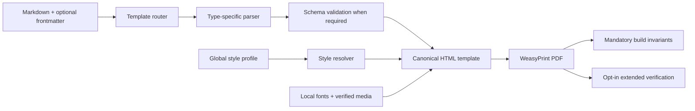

# Plan: Complete Markdown-to-PDF Skill

## Outcome

Turn the project-owned `md-to-pdf` skill into a reusable, nearly deterministic PDF document system. It accepts Markdown as the editable source, selects a suitable template from context or an explicit choice, renders canonical HTML, and creates PDFs with WeasyPrint. The skill, code comments, errors, and maintained documentation are written in English. Document content may be in Latin-script languages, initially Portuguese and English.

Kami is an architectural and quality reference, not the source of this project's visual defaults. The approved résumé layout remains visually unchanged. No web pages, PPTX, Tailwind build step, or repository license are part of this plan.

## Confirmed product contract

### Document types

| Type | Content shape | Page contract |
| --- | --- | --- |
| Résumé | Existing validated résumé structure, skills last | Approved two-page A4 layout |
| Cover letter | Sender, recipient, subject, salutation, body, sign-off | One A4 page |
| Proposal | Cover metadata, numbered sections, tables where meaningful | A4; length follows content |
| Plain document | General Markdown headings, lists, tables, code, images | A4; natural pagination |
| One-pager | Central message and flexible supporting sections; metrics optional | One A4 page |
| Long document | Chapters, evidence, figures, tables, references as needed | A4; natural pagination |
| Portfolio | Case studies with context, approach, and supported outcome; images optional | A4; natural pagination |
| Pitch deck | Assertion-led slides separated by top-level `---` | One 16:9 PDF page per slide |
| Analytical report | Thesis, evidence, analysis, risks, conclusion; financial tables optional | A4; target set by request |
| Changelog | Version/release groups and user-facing changes | A4; natural pagination |

Initial pitch-deck layouts: cover, assertion with evidence, comparison, metrics/chart, timeline, and closing. A one-pager does not require invented metrics. Portfolio and report schemas must allow missing optional material without inventing results or facts.

### Template and source selection

- The agent infers the template from the request and source. When two templates genuinely fit or none fits, ask the user to choose or authorize a new template.
- Direct CLI builds require `--template` or `template` in YAML frontmatter. Optional frontmatter also supports `lang`, `title`, and per-document style overrides.
- Markdown remains the editable and factual source. Résumés, decks, portfolios, and analytical reports generate validated structured intermediates; other types can render directly from Markdown.
- A deck's `---` markers after frontmatter separate slides only at the top level, not inside code fences or embedded data.
- Ellipses are editorial content in the Markdown, never automatic renderer truncation.

### Visual rules

- Keep `assets/templates/resume-ats.html` as the approved, isolated résumé visual source. Shared tokens and global font preferences do not restyle it unless the user explicitly requests a design change.
- Start the other templates from the proposal's sans-serif, white-paper, neutral direction. Use project-owned palette, typography, spacing, tables, and page rules. Do not copy Kami's serif default or color values.
- `references/design.md` is the human-readable design contract; `assets/styles/tokens.css` and templates hold executable values. A design-guide change requires corresponding code changes and a consistency check.
- `CHEATSHEET.md` is a short user-facing reference, not the source of executable defaults.
- Never shrink fonts, change spacing, alter page geometry, or truncate content automatically to make a document fit. Adapt content to the chosen template. A user-requested layout change is a separate edit to template elements or the design guide and implementation.
- For a one-page document or slide that cannot fit, identify the overflowing block and stop for editorial revision. Long documents paginate naturally while keeping headings, table rows, and figures together where feasible.

### Profile and fonts

- On first interactive use, ask whether the user wants the default style or a custom style. If custom, ask only for font, accent color, and paper color. Save the choice globally at `~/.config/md-to-pdf/profile.json`; explicit document options override it. The CLI uses defaults without an interactive profile.
- Accept bundled or user-supplied local fonts, Google Fonts, and Fontsource. Ask permission before every new download. Cache only the selected family, required weights/styles, and Latin-script subsets outside the distributed skill. Reuse cached files without downloading again.
- Use local `@font-face` resources when rendering, with resolved paths and font-family fallbacks. Pin external versions or cache immutable files. If an explicitly selected font is unavailable or not embedded as requested, fail clearly rather than silently substituting it.
- The résumé's locked visual design takes precedence over global font choices.

### Media and accessibility

- Accept logos and images supplied by the user or obtained from verifiable official sources; never invent replacement brand assets.
- Start with reusable bars, lines, metric displays, flowcharts, and timelines driven by structured Markdown data. Users do not edit SVG coordinates manually.
- Selected Kami diagram SVG implementations may be adapted to this project's style. Retain the required MIT copyright and permission notice with reused material. Update the existing `AGENTS.md` prohibition only for these explicitly selected diagrams when they are actually imported; do not add a repository-wide license.
- Templates include document language, title, logical reading order, descriptive links, and alt text for informative images.

## Target architecture



Use one template registry and one `scripts/build.py` entry point. Keep the existing scripts as compatibility paths during migration. Share a WeasyPrint renderer, font resolver, profile loader, and output handling across types. Preserve the saved HTML as the source of each PDF, including cover letters after migration from ReportLab. Structured intermediates are generated artifacts, not independent editorial files.

Recommended skill layout when each file has real content:

```text
.agents/skills/md-to-pdf/
  SKILL.md
  CHEATSHEET.md
  assets/
    styles/tokens.css
    templates/*.html
    diagrams/                 # selected, attributed SVG implementations
  references/
    design.md
    schemas/*.json
    font-sources.md
  scripts/
    build.py                  # unified CLI
    render_pdf.py
    verify.py
    ...type parsers/renderers
  tests/
    fixtures/*.md            # synthetic content only
    test_build_*.py
```

## Verification strategy

The build always stops for invalid Markdown, invalid required schema content, an unavailable explicitly selected font, or an empty/unreadable PDF. It never changes visual rules to force success.

The extended `build.py --verify` suite is opt-in during development. It checks page count and dimensions against the template contract, remaining placeholders, text extraction and required-content coverage, embedded fonts, link annotations, language/metadata, page geometry, and obvious overflow. A fixture-generation script builds every Template from synthetic Markdown and saves HTML, PDF, every page image, and a review manifest. A human inspects clipping, overlaps, awkward breaks, and chart labels; agents prepare evidence but cannot approve layout quality.

Before public release, run `--verify` and automated business-rule tests over the full synthetic fixture matrix and record human visual approval of every Template. Resolve reproducible overflow, clipping, missing-glyph, and pagination defects. Generated PDFs, HTML previews, page images, and private documents remain ignored local outputs.

### Required generation tests

Each row needs a synthetic Markdown fixture that runs through the public unified command and checks HTML/PDF creation, expected size/page behavior, extractable text, and absence of raw placeholders or dropped required fields.

| Type | Minimum generation assertion |
| --- | --- |
| Résumé | Validated sidecar; two A4 pages; all roles and skills last; approved template unchanged |
| Cover letter | One A4 page; sender/recipient/body/sign-off retained; HTML and PDF agree |
| Proposal | Cover metadata, numbered sections, tables and links retained |
| Plain document | Headings, lists, code, tables, images and natural page breaks render |
| One-pager | One A4 page with and without metrics; no fabricated fields |
| Long document | Multiple chapters, figures/tables, running page behavior, no orphan heading |
| Portfolio | Multiple case studies, optional images, supported outcomes retained |
| Pitch deck | One 16:9 page per slide; each initial layout renders; `---` in code is not a slide break |
| Analytical report | Schema validation, evidence/risks/conclusion, optional financial table |
| Changelog | Versions, dates, categories and links retained in order |

Add edge-case fixtures for long titles, dense slides, large tables, long URLs, accented Latin text, alternative fonts, missing glyphs, images with and without alt text, invalid frontmatter, malformed chart data, and intentionally overflowing one-page content. Use temporary XDG config and font caches in tests; mock remote font providers and assert that no download happens without permission. Test routing, schema rules, precedence, consent, content preservation, overflow, and document contracts automatically. Do not commit generated PDFs or personal data. The fixture gallery supports human page-by-page review, with acceptance recorded separately.

## Implementation phases

1. **Foundation:** document the project visual system and template registry; add unified CLI, profile/onboarding contract, local font resolution, shared WeasyPrint renderer, and mandatory build invariants. Preserve résumé output.
2. **Existing paths:** route résumé, proposal, and plain document through the registry; migrate cover letter to its HTML template and WeasyPrint; add generation tests for all four.
3. **Document catalog:** add one-pager, long document, portfolio, analytical report, and changelog with the agreed schemas and synthetic generation tests.
4. **Pitch deck and media:** add 16:9 slide templates, structured charts/diagrams, selected attributed Kami SVGs, and per-layout tests.
5. **Extended verification:** implement opt-in checks, business-rule tests, a fixture-gallery script, and human visual review workflow; fix defects uncovered by the matrix without silent layout changes.
6. **Public readiness:** run the entire suite, inspect every template, verify documentation and English-only maintained instructions, check dependency/package size, then update compatibility guidance and release notes. Publish only after these gates pass.

## Current implementation and migration risks

- The current résumé already has Markdown → validated JSON → canonical HTML → WeasyPrint. Its visual output is the regression baseline.
- The proposal has its own parser, HTML shell, and Geist tokens; move these into the registry without changing its output unintentionally.
- The plain document keeps CSS inside `build-document.py`; extract it into a maintained template/style layer.
- The cover letter was migrated from ReportLab to saved canonical HTML and WeasyPrint. A synthetic one-page fixture compares its visible text and geometry with the prior renderer.
- Fonts alter line metrics and pagination. Explicit font changes require a fresh render and fit check; the résumé ignores profile fonts by default.
- The repository currently forbids Kami asset use and has no license. Reusing selected MIT diagrams requires a narrow rule update and retained upstream notice at implementation time.

## References reviewed

- Project: `.agents/skills/md-to-pdf/`, `AGENTS.md`, and the earlier `docs/plans/resume-studio-assets-content-json.md`.
- Kami: `SKILL.md`, `CHEATSHEET.md`, `references/design.md`, `references/brand-profile.md`, `references/tokens.json`, `scripts/render.py`, `scripts/content.py`, `scripts/verify.py`, and selected diagram HTML/SVG files.
